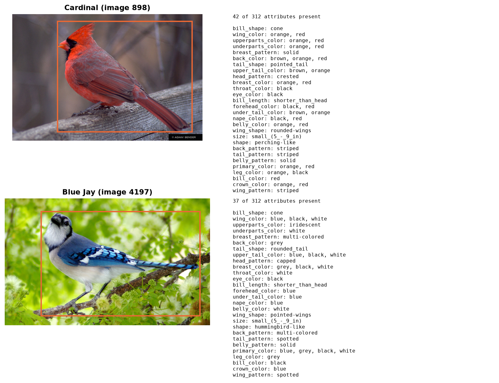
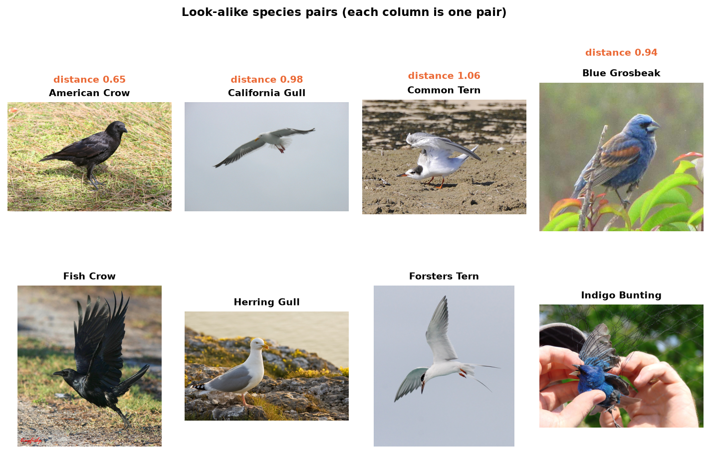
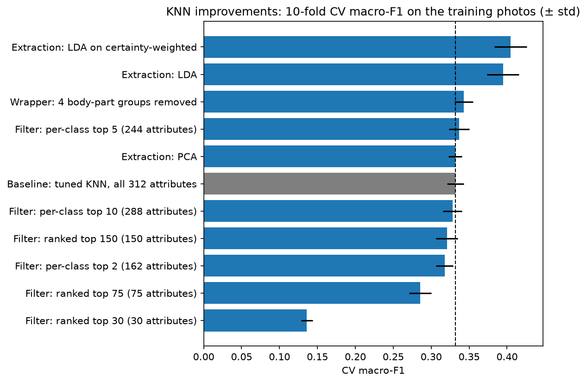
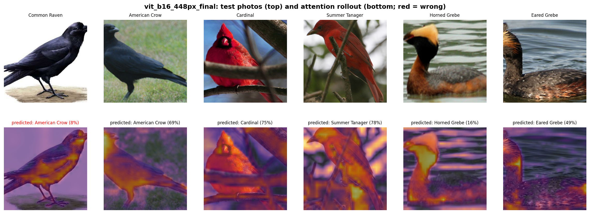

# Birds' Species Classification (CUB-200-2011)

**Group name:** The Machine Teachers (Malaysia Group 2)

**Project title:** Classifying 200 bird species from visual attributes and photographs, and combining the two.

F20DL Data Mining and Machine Learning, Group Coursework 2026/27, Heriot-Watt University Malaysia.

## Group members

| Name | Role | Main work |
| ---- | ---- | --------- |
| Suhaib Hameed Zuberi | Team Lead | R3 logistic regression; R4 MLP, EfficientNet-B0 |
| Tengku Adam Syafiq | Presentation and Pitch Lead | R3 k-NN; R4 ViT-B/16; model ensemble; data download script |
| Ryan Goh | Data Management Lead | R2 data preparation; R3 decision tree, random forest; R4 ResNet-50, higher-resolution runs |
| Muhammad Faizal Haris bin Aidi | Configuration Management Lead | R2 data analysis (EDA, encodings, feature selection, clustering, image checks); repository |
| David Ling | Final Report Lead | R2 image pipeline and augmentation; R4 base CNN |

## Milestones

| Milestone | When |
| --------- | ---- |
| D1 Project pitch | Week 4 (done) |
| R2 Data analysis | done, 7 Nov 2026 |
| R3 Baseline models | done, 16 Nov 2026 |
| R4 Neural networks and ensemble | done, 23 Nov 2026 |
| D2 Report and code | Week 11, 25 Nov 2026, 15:30 |
| D3 Mini-viva | Week 12, 30 Nov 2026 |

## Dataset

- **True source:** Caltech-UCSD Birds-200-2011 (CUB-200-2011), California Institute of Technology
  ([dataset page](https://www.vision.caltech.edu/datasets/cub_200_2011/)); Wah, C. et al. (2011) Technical Report CNS-TR-2011-001.
- **Licence:** non-commercial research and educational use only (the photos come from Flickr).
- **How we get it:** the Kaggle mirror [`wenewone/cub2002011`](https://www.kaggle.com/datasets/wenewone/cub2002011), identical to the original plus one file that repairs 606 malformed attribute lines.
- **Two datasets from one source:** 11,788 photos of 200 species, each with (1) 312 binary visual attributes (tabular) and (2) the photo with a bounding box (images). Official split: 5,994 train / 5,794 test.
- **Additional data collection:** none.

**Two examples**



| image_id | Species | Attributes present | Some of its attributes |
| -------- | ------- | ------------------ | ---------------------- |
| 898 | Cardinal | 42 of 312 | `has_bill_shape::cone`, `has_primary_color::red`, `has_head_pattern::crested` |
| 4197 | Blue Jay | 37 of 312 | `has_bill_shape::cone`, `has_primary_color::blue`, `has_wing_pattern::spotted` |

## Installation

Python 3.12. All packages are pinned in `requirements.txt`.

```bash
python -m venv .venv
.venv\Scripts\activate            # macOS / Linux: source .venv/bin/activate
pip install -r requirements.txt
python scripts/download_data.py    # needs a Kaggle API token; downloads into data/raw/
```

The image models (R4) were trained on Google Colab GPUs; each R4 notebook explains how to run it there.

## Data preparation pipeline

Run these in order with Jupyter (`jupyter lab`, then _Run All_):

| Step | File | What it does |
| ---- | ---- | ------------ |
| 1 | [`dataPrep.ipynb`](notebooks/dataPrep.ipynb) | Repairs and reshapes the attribute labels into one row per photo; builds encodings A/B/C of "not visible" (`data/cub_features_*.csv`). Decisions in [`tabularDataAnalysis.md`](tabularDataAnalysis.md). |
| 2 | [`imagePrep.ipynb`](notebooks/imagePrep.ipynb) | Checks the photos and bounding boxes; writes `data/cub_images.csv`. |
| 3 | `python scripts/prepare_images.py` | Converts to RGB, crops each bird to its box plus 10% and resizes. |
| 4 | [`05_image_preparation.ipynb`](notebooks/05_image_preparation.ipynb) | Checks the crops and shows the training-only augmentation ([`augmentation.py`](scripts/augmentation.py)). |

Tabular models only need step 1. The image notebooks run steps 2–4 themselves on Colab.

## R2: Data analysis and exploration

**Notebooks:** [`eda.ipynb`](notebooks/eda.ipynb), [`annotatorCertainty.ipynb`](notebooks/annotatorCertainty.ipynb), [`featureSelection.ipynb`](notebooks/featureSelection.ipynb), [`clustering.ipynb`](notebooks/clustering.ipynb), [`imagePrep.ipynb`](notebooks/imagePrep.ipynb)

**Input:** the 312 attributes and the photos. **Output:** figures, the default encoding (A) and `data/feature_sets.json`.

The attributes are sparse (about 31 of 312 per photo), noisy (one annotator) and redundant, and 127 of 200 species have a
close look-alike (e.g. American vs Fish Crow). Plain 0/1 encoding (A) was best. Feature selection (Cramér's V) showed all
312 attributes are needed. Clustering species profiles (K-Means, GMM/EM) found visual groups such as gulls and terns,
sparrows and warblers, with every look-alike pair in the same cluster.

| Feature set | Logistic regression macro-F1 (5-fold CV) |
| ----------- | ---------------------------------------- |
| All 312 attributes | 0.473 |
| Top 150 | 0.460 |
| Top 75 | 0.372 |
| Top 30 | 0.146 |



## R3: Baseline models

**Notebooks:** [`decisionTree.ipynb`](notebooks/decisionTree.ipynb), [`randomForest.ipynb`](notebooks/randomForest.ipynb), [`knn.ipynb`](notebooks/knn.ipynb), [`knn_improvements.ipynb`](notebooks/knn_improvements.ipynb), [`logistic_regression.ipynb`](notebooks/logistic_regression.ipynb)

**Input:** the 312 attributes (encoding A). **Output:** the species (200 classes).

Hyperparameters were tuned with stratified cross-validation on the training set, then each model was tested once on
the official test set. Logistic regression did best, but all models stay below 50% because look-alike species have
near-identical attributes.

| Model | Test accuracy | Test macro-F1 |
| ----- | ------------- | ------------- |
| Decision tree | 24.7% | 0.245 |
| k-NN | 35.2% | 0.349 |
| k-NN + LDA | 44.4% | 0.420 |
| Random forest | 45.2% | 0.432 |
| Logistic regression | **47.4%** | **0.480** |



## R4: Neural networks

**Notebooks:** [`multilayer_perceptron_tabular.ipynb`](notebooks/multilayer_perceptron_tabular.ipynb), [`base_cnn_224px.ipynb`](notebooks/base_cnn_224px.ipynb), [`base_cnn.ipynb`](notebooks/base_cnn.ipynb), [`resnet50_altered_224px.ipynb`](notebooks/resnet50_altered_224px.ipynb), [`resnet50.ipynb`](notebooks/resnet50.ipynb), [`efficientnetb0_fine_tuned.ipynb`](notebooks/efficientnetb0_fine_tuned.ipynb), [`vit.ipynb`](notebooks/vit.ipynb), [`vit_448px.ipynb`](notebooks/vit_448px.ipynb); ensemble: [`consolidation.ipynb`](notebooks/consolidation.ipynb), [`vit_448px_consolidation.ipynb`](notebooks/vit_448px_consolidation.ipynb)

**Input:** the attributes (MLP) or the cropped photos. **Output:** the species (200 classes).

The image models chose their learning rate on a 20% validation split, were retrained on all training photos and tested
once. Pretraining mattered most: the CNN trained from scratch reached 57%, every ImageNet-pretrained network over 73%.
Combining the 448 px ViT's top 5 with the random forest (weight chosen on validation) gave the best result.

| Model | Input | Test accuracy | Test macro-F1 |
| ----- | ----- | ------------- | ------------- |
| MLP | attributes | 46.8% | 0.471 |
| Base CNN (from scratch) | photo, 224 / 448 px | 57.0% / 57.0% | 0.570 / 0.569 |
| EfficientNet-B0 | photo, 224 px | 73.6% | 0.735 |
| ResNet-50 | photo, 224 / 448 px | 80.3% / 81.9% | 0.801 / 0.818 |
| ViT-B/16 | photo, 224 / 448 px | 82.0% / 84.2% | 0.820 / 0.841 |
| Ensemble: ViT 448 px + random forest | both | **85.4%** | **0.853** |



## Use of generative AI

This project used generative AI only as the coursework allows: **code generation with human evaluation** (Framework Statement 6) for the notebooks and scripts, and **editing and proofreading only** (Framework Statement 4) for the written report. The tool used was **Claude (Anthropic)** among ot.

**How we used it**

- Before using GenAI for a task, each member studied the relevant lectures, labs and tutorials, and decided on the approach (models, features, splits, metrics and hyperparameter ranges).
- We then used Claude to explore options for that approach, and to generate or adapt code for it, often starting from a teammate's notebook so that every model shares the same data pipeline and protocol.
- Every member ran their code end to end, checked the outputs against the data, and edited the code where it was wrong or did not match our decisions. All design decisions, the interpretation of results and the conclusions are our own.
- GenAI was not used to write the report's content. It was only used to correct grammar, spelling and wording in text we had written ourselves.
- GenAI was also used to explore ideas, techniques, and help with debugging.

**Where each use is declared**
Each notebook and script states its own GenAI use, including the prompt(s) used or at least a description of the instruction given to the AI, either at the top of the notebook (the "Generative AI Declaration" or "GenAI disclosure" block in the first markdown or code cell) or as comments on the specific cells it helped with. The member responsible for each file is named in its declaration.
