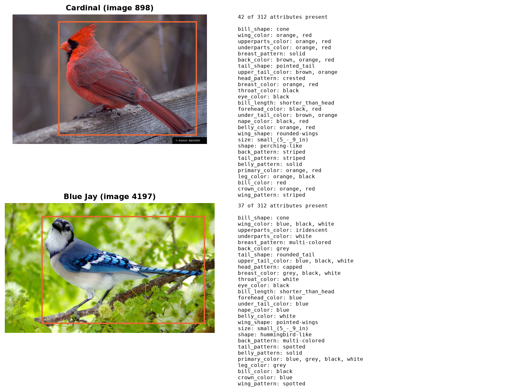
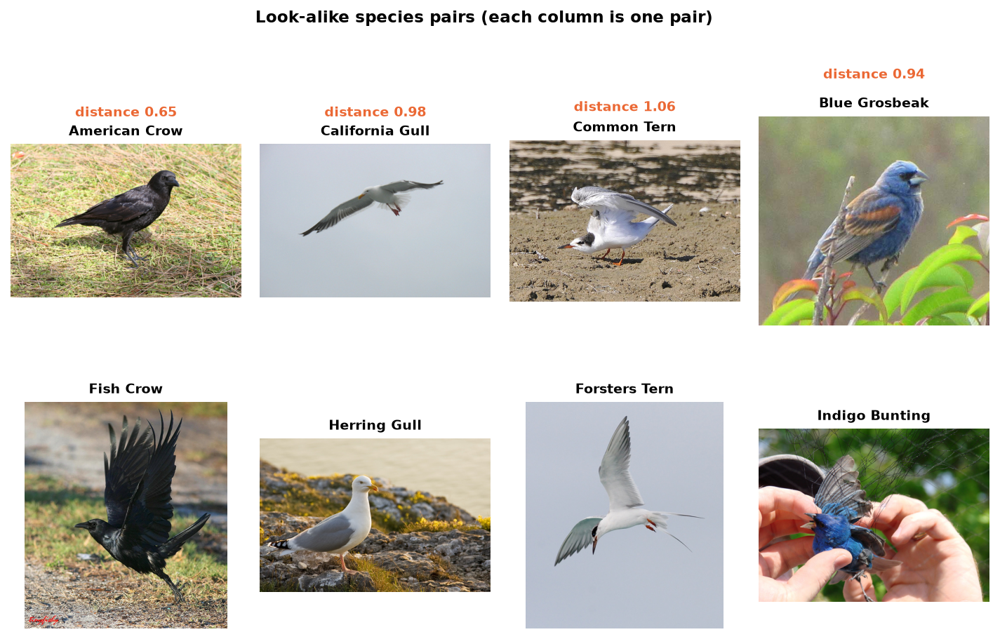
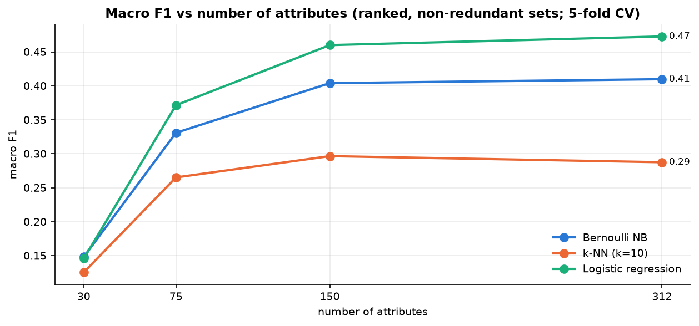
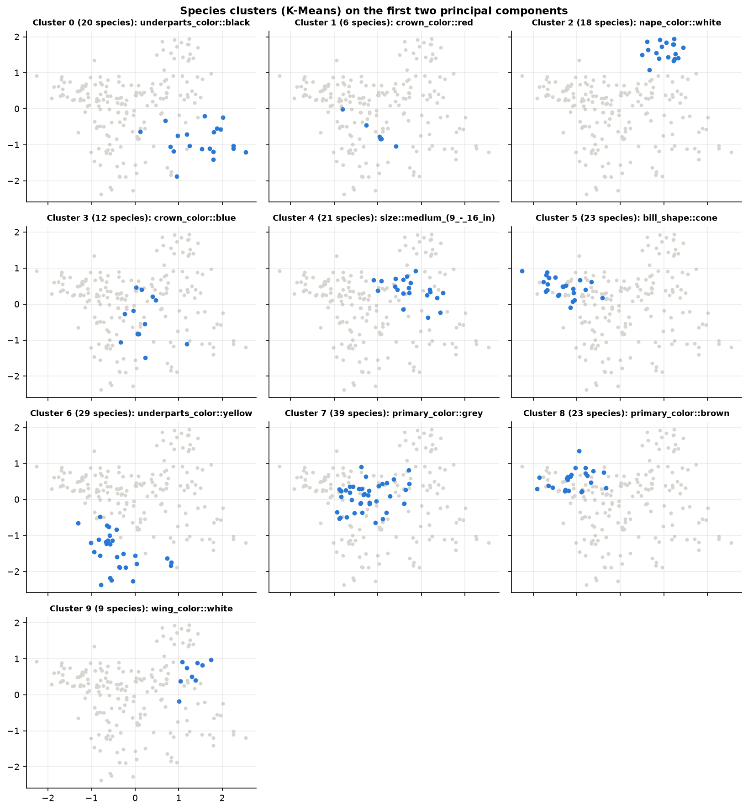
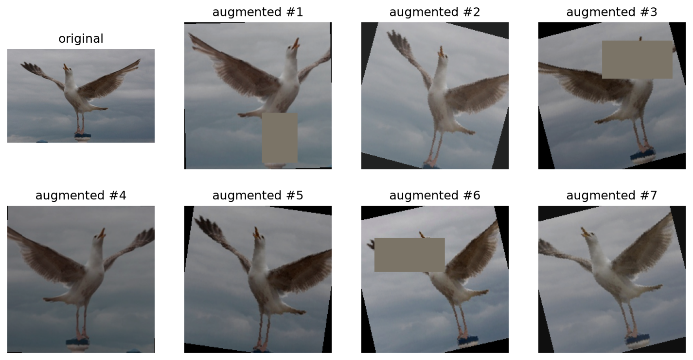

# Birds' Species Classification (CUB-200-2011)

> F20DL/F21DL Data Mining and Machine Learning, Group Coursework 2026/27, Heriot-Watt University Malaysia

**Group name:** _TODO (team lead)_

**Project title:** Classifying 200 bird species from visual attributes and photographs.

## Group members

| Name | Role | Requirement work |
|---|---|---|
| Suhaib Hameed Zuberi | Team Lead | R3: logistic regression |
| Tengku Adam Syafiq | Presentation and Pitch Lead | R3: k-NN; data download script |
| Ryan Goh | Data Management Lead | R2: tabular data preparation; R3: decision tree, random forest |
| Muhammad Faizal Haris bin Aidi | Configuration Management Lead | R2: EDA, annotator certainty, feature selection, clustering, image checks |
| David Ling | Final Report Lead | R2: image pipeline for R4 (crop, resize, augmentation); meeting logs |

## Project milestones

_TODO (team lead): confirm the dates._

| Milestone | Target |
|---|---|
| D1 Project pitch | Week 4 (done) |
| R2 Data analysis and exploration | _TODO_ |
| R3 Baseline models | _TODO_ |
| R4 Neural networks | _TODO_ |
| D2 Report + code | Week 11: Wed 25 Nov 2026, 15:30 |
| D3 Mini-viva | Week 12: Mon 30 Nov 2026 |

---

## Dataset

### Source and licence

| | |
|---|---|
| **Dataset** | Caltech-UCSD Birds-200-2011 (CUB-200-2011) |
| **True source** | California Institute of Technology: [dataset page](https://www.vision.caltech.edu/datasets/cub_200_2011/), archive on [Caltech Data](https://data.caltech.edu/records/65de6-vp158) |
| **How we download it** | Kaggle mirror [`wenewone/cub2002011`](https://www.kaggle.com/datasets/wenewone/cub2002011), via `scripts/download_data.py` |
| **Licence** | Non-commercial research and educational use only. Caltech does not own the copyright of the photos (they come from Flickr). |
| **Citation** | Wah, C., Branson, S., Welinder, P., Perona, P. and Belongie, S. (2011) *The Caltech-UCSD Birds-200-2011 Dataset*. Technical Report CNS-TR-2011-001, California Institute of Technology. |

The Kaggle mirror is the official archive plus one extra file, `image_attribute_labels_clean.txt`, which repairs 606
malformed lines of the original. `dataPrep.ipynb` verifies that this file is exactly the original with those lines fixed,
so nothing else differs from the true source.

### Two datasets from one source

| | Dataset 1: tabular (R2, R3) | Dataset 2: images (R4) |
|---|---|---|
| Rows | 11,788 photos | 11,788 photos |
| Inputs | 312 binary visual attributes (bill shape, wing colour, ...) from 28 body-part groups, labelled by Amazon Mechanical Turk workers | the photograph + a bounding box around the bird |
| Target | species (200 classes) | species (200 classes) |
| Split | official `train_test_split.txt`: 5,994 train / 5,794 test | same photos, same split |

### Two examples



| image_id | species | split | attributes present (of 312) | some of its attributes |
|---|---|---|---|---|
| 898 | Cardinal | train | 42 | `has_bill_shape::cone`, `has_primary_color::red`, `has_head_pattern::crested`, `has_size::small_(5_-_9_in)` |
| 4197 | Blue Jay | train | 37 | `has_bill_shape::cone`, `has_primary_color::blue`, `has_crown_color::blue`, `has_wing_pattern::spotted` |

### Additional data collection

None. No data was added to the original dataset.

---

## Getting started

### 1. Environment

_TODO (group decision, 5 Nov): keep ONE dependency file with every version pinned, on Python 3.12 (the kernel crashes
on 3.14). Right now there are three: `requirements.txt`, `environment.yml`, `environment-3.12.yml`. Update this section
once the group has picked one._

With `requirements.txt` (works for venv and conda):

```bash
python -m venv .venv                      # or: conda create -n f20dl python=3.12, then conda activate f20dl
.venv\Scripts\activate                    # Windows (macOS / Linux: source .venv/bin/activate)
pip install -r requirements.txt
pip install torch torchvision             # only needed for the image models (R4)
```

### 2. Getting the data (about 1.1 GB, never committed to git)

**Option A, download:** create a Kaggle API token (kaggle.com > Settings > API > Create New Token), put `kaggle.json` in
`C:\Users\<you>\.kaggle\` (Windows) or `~/.kaggle/`, then from the repo root:

```bash
python scripts/download_data.py      # unzips into data/raw/
```

**Option B, copy:** if you already have the Kaggle copy, put its `CUB_200_2011/` folder inside `data/raw/`.

Either way you end up with `data/raw/CUB_200_2011/`. (A `CUB_200_2011/` folder at the repo root also still works.)

### 3. Run the pipeline

Start Jupyter (`jupyter lab`) and run the notebooks in this order with *Run All*:

| # | Notebook | Owner | Input | Output | Needed by |
|---|---|---|---|---|---|
| 1 | [`dataPrep.ipynb`](notebooks/dataPrep.ipynb) | Ryan | attribute files | `data/cub_features_A/B/C.csv` | **all tabular models** |
| 2 | [`eda.ipynb`](notebooks/eda.ipynb) | Faizal | `cub_features_A.csv` | figures only | report |
| 3 | [`annotatorCertainty.ipynb`](notebooks/annotatorCertainty.ipynb) | Faizal | `cub_features_A/B/C.csv`, certainty labels | figure + cleaning decision | report |
| 4 | [`featureSelection.ipynb`](notebooks/featureSelection.ipynb) | Faizal | `cub_features_A.csv` | `data/feature_sets.json` | R3 (optional feature subsets) |
| 5 | [`clustering.ipynb`](notebooks/clustering.ipynb) | Faizal | `cub_features_A.csv` | figures only | report |
| 6 | [`imagePrep.ipynb`](notebooks/imagePrep.ipynb) | Faizal | photos, bounding boxes | `data/cub_images.csv` | R4 |
| 7 | `python scripts/prepare_images.py` | David | `cub_images.csv` + photos | `data/processed/images_cropped/`, `cub_images_cropped.csv` | **R4 (CNN)** |
| 8 | [`05_image_preparation.ipynb`](notebooks/05_image_preparation.ipynb) | David | cropped photos | checks + figures | report |
| – | model notebooks (`decisionTree*`, `randomForest*`, `knn`, `logistic_regression`) | R3 owners | `cub_features_*.csv` or raw files | `results/` | report |

**If you only train a tabular model, you only need step 1.** Steps 2–5 explain the data and back up the cleaning choices
for the report. Steps 6–8 are only needed for the neural network.

The generated CSVs are git-ignored (`/data/*.csv`): re-run the notebook that makes a file to recreate it.
`data/feature_sets.json` is small and is committed.

### 4. Loading the prepared data in a model notebook

```python
import pandas as pd
from pathlib import Path

ROOT = Path.cwd() if (Path.cwd() / 'data').exists() else Path.cwd().parent
META_COLS = ['image_id', 'class_id', 'class_name', 'is_train']   # never use as features

df = pd.read_csv(ROOT / 'data' / 'cub_features_A.csv')
features = [c for c in df.columns if c not in META_COLS]
train, test = df[df.is_train == 1], df[df.is_train == 0]          # official split
X_train, y_train = train[features], train.class_id
X_test, y_test = test[features], test.class_id
```

**For the CNN** (after steps 6 and 7, with `torch` and `torchvision` installed):

```python
import sys; sys.path.insert(0, "../scripts")
from augmentation import make_loaders

train_loader, val_loader, test_loader = make_loaders("../data/processed", batch_size=32)
# train_loader is augmented (training photos only); val/test are only resized.
# Validation is 20% of the official training split; the official test split is untouched.
# Labels in the loaders are 0-199 (class_id - 1).
```

### Pipeline change log

| Date | Change | By |
|---|---|---|
| 2026-10-21 | `dataPrep.ipynb`, feature variants A/B/C | Ryan |
| 2026-10-22 | `scripts/download_data.py` (Kaggle download into `data/raw/`) | Tengku |
| 2026-11-04 | `dataPrep.ipynb` reads the dataset from `data/raw/`; `environment.yml`, `environment-3.12.yml` | Suhaib |
| 2026-11-05 | Image pipeline: `prepare_images.py`, `augmentation.py`, `05_image_preparation.ipynb` | David |
| 2026-11-05 | R2 analysis notebooks and `imagePrep.ipynb` added on top of `dataPrep`; dataset found in `data/raw/` or the repo root; image pipeline reads `data/cub_images.csv` | Faizal |

---

## R2: Data analysis and exploration

**What is predicted:** the bird species (200 classes), from 312 binary attributes (Dataset 1) or from the photo (Dataset 2).

**Cleaning** ([`dataPrep.ipynb`](notebooks/dataPrep.ipynb), decisions in
[`tabularDataAnalysis.md`](tabularDataAnalysis.md)). The 606 malformed lines are repaired, 3.68 million labels are
reshaped into one row per photo, and three encodings of "not visible" are built (A raw 0/1, B −1, C extra flags). There
are no missing values. Training classes are balanced (29–30 photos per species).

**Annotator certainty** ([`annotatorCertainty.ipynb`](notebooks/annotatorCertainty.ipynb)). Every encoding, including the
"drop guessing positives" switch, was tested with three models (5-fold CV on the training set, macro-F1):

| Option | Decision tree | Logistic regression | k-NN (k=10) |
|---|---|---|---|
| **A, raw 0/1** | **0.237** | **0.473** | **0.283** |
| A, guesses dropped | 0.229 | 0.461 | 0.272 |
| B, not visible = −1 | 0.233 | 0.432 | 0.137 |
| C, + 28 not-visible flags | 0.227 | 0.466 | 0.272 |

Variant A is best or tied for every model, so it is the default input, with `DROP_GUESSING_POSITIVES = False`.

**EDA** ([`eda.ipynb`](notebooks/eda.ipynb)). The data is sparse (about 31 of 312 attributes present per photo) and noisy
(one annotator per photo). The same colour on neighbouring body parts is strongly correlated, so many attributes are
redundant. 127 of the 200 species have a look-alike species closer than half the typical distance between species (for
example American Crow vs Fish Crow), which is the core difficulty of this fine-grained task. PCA needs 77 components to
keep 80% of the variance, so there is no small set of directions that explains the data.



**Feature selection** ([`featureSelection.ipynb`](notebooks/featureSelection.ipynb)). Attributes ranked by Cramér's V
(checked against information gain) on the training set only; 19 redundant attributes removed (|φ| > 0.8); subsets
evaluated with 5-fold CV (macro-F1):

| Feature set | n | Bernoulli NB | Logistic regression | k-NN (k=10) |
|---|---|---|---|---|
| all attributes | 312 | **0.410** | 0.473 | 0.283 |
| best 10 per class | 288 | 0.408 | **0.479** | 0.288 |
| ranked top 150 | 150 | 0.404 | 0.460 | **0.297** |
| ranked top 75 | 75 | 0.331 | 0.372 | 0.267 |
| ranked top 30 | 30 | 0.148 | 0.146 | 0.129 |

Removing attributes does not help much: about 150 attributes are needed to keep the accuracy of the full set. The subsets
are saved in `data/feature_sets.json` for anyone who wants to try them in R3.



**Clustering** ([`clustering.ipynb`](notebooks/clustering.ipynb)). K-Means on individual photos finds no natural groups
(silhouette 0.01–0.07, agreement with species ARI 0.12). On the 200 species profiles, K-Means (k = 10, chosen by
silhouette) and a Gaussian Mixture Model (EM, 8 components chosen by BIC) find clear visual groups: a white seabird group
(gulls and terns), a yellow group (warblers), a buff, cone-billed group (sparrows), a black-and-white group (woodpeckers),
and others. Every look-alike pair falls in the same cluster, which confirms the EDA finding.



**Image preparation for R4** ([`imagePrep.ipynb`](notebooks/imagePrep.ipynb),
[`05_image_preparation.ipynb`](notebooks/05_image_preparation.ipynb)). No photo is missing or corrupt. 8 photos are
greyscale, sizes vary, 8 bounding boxes go past the photo border (clipped), and the bird typically fills only about a
third of the photo. So every photo is converted to RGB, cropped to its box plus a 10% margin and resized to 256 px on
the shorter side. With only about 30 training photos per species, training photos (only) are augmented on the fly:
random crop, horizontal flip, ±15° rotation, small lighting changes and random erasing. There is no vertical flip and
almost no hue change, because colour separates look-alike species. A 20% validation set is taken from the training
split before augmentation, and the test split is never augmented.



## R3: Baseline models

_TODO (R3 owners): finalise the table, add figures and the chosen model._

Current results on the official test set, as reported in [`tabularDataAnalysis.md`](tabularDataAnalysis.md) and
[`results/`](results/):

| Model | Notebook | Test accuracy | Test macro-F1 |
|---|---|---|---|
| Decision tree | [`decisionTree.ipynb`](notebooks/decisionTree.ipynb) | 24.7% | _TODO_ |
| Random forest | [`randomForest.ipynb`](notebooks/randomForest.ipynb) | 45.6% | _TODO_ |
| k-NN (k=21, cosine, distance-weighted) | [`knn.ipynb`](notebooks/knn.ipynb) | 34.7% | 0.342 |
| Logistic regression | [`logistic_regression.ipynb`](notebooks/logistic_regression.ipynb) | 47.4% | _TODO_ |

## R4: Neural networks

_TODO (R4 owners): what is predicted, inputs, results table, figure, links._ Load the photos with `make_loaders()`
(see "Loading the prepared data" above).
